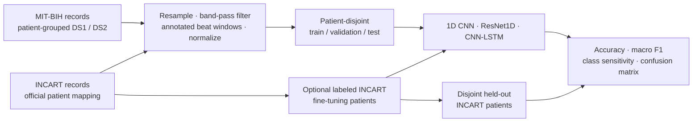

# ECG Arrhythmia Detection Across Datasets

A reproducible research project for classifying ECG heartbeats and testing
whether models trained on MIT-BIH generalize to the independently collected
INCART database. It compares a 1D CNN, a residual 1D CNN, and a CNN-LSTM, with
an optional patient-disjoint INCART fine-tuning experiment.

> **Research prototype, not a medical device.** Predictions are for research
> and educational use only; they are not clinical advice or a diagnostic tool.

## Pipeline



GitHub Actions runs the unit tests and CLI check on Python 3.10 and 3.12 for
each push and pull request.

## Research questions

1. How do the three architectures perform on a patient-independent MIT-BIH
   test set?
2. How much does performance change on INCART without retraining?
3. Does fine-tuning on a patient-disjoint subset of INCART improve performance
   on held-out INCART patients?

## Data and evaluation design

- **MIT-BIH Arrhythmia Database** (`mitdb`): the conventional DS1/DS2
  inter-patient partition is used, with one patient-safety correction: records
  201 and 202 are from the same subject, so record 202 is grouped with 201 in
  DS1 rather than left in DS2. DS1 is divided into patient-disjoint training
  and validation groups; DS2 is held out for internal testing.
- **INCART 12-lead Arrhythmia Database** (`incartdb`): all records are
  external test data for the cross-dataset result. Its official
  `files-patients-diagnoses.txt` mapping is used to keep recordings from the
  same patient together. Optional fine-tuning splits INCART by patient into
  adaptation, adaptation-validation, and held-out test groups.

Only annotated beat symbols in the following AAMI-style groups are retained:

| Class | Meaning | Beat symbols |
|---|---|---|
| N | Normal and bundle-branch beats | `N`, `L`, `R`, `e`, `j` |
| S | Supraventricular ectopic beats | `A`, `a`, `J`, `S` |
| V | Ventricular ectopic beats | `V`, `E` |

Other symbols are excluded rather than silently relabeled. The first lead
named `MLII` or `II` is selected when present; otherwise the first available
lead is used. Signals are resampled to 360 Hz, band-pass filtered from 0.5 to
40 Hz, segmented around annotated beat locations, and z-score normalized
per beat. A beat has 0.30 seconds before and 0.40 seconds after its annotation.
Boundary-truncated beats are excluded.

## Setup

Python 3.10 or newer is required.

```bash
python -m venv .venv
source .venv/bin/activate          # Windows: .venv\Scripts\activate
python -m pip install -e ".[dev]"
```

Download both public PhysioNet datasets (this may take a while):

```bash
ecg-arrhythmia download --dataset all --data-dir data
```

The downloader also saves INCART's patient/record mapping file. The expected
layout is `data/mitdb/` and `data/incartdb/`; raw data are excluded from Git.
PhysioNet access terms and citations apply:
[MIT-BIH](https://physionet.org/content/mitdb/) and
[INCART](https://physionet.org/content/incartdb/).

## Run the experiments

Train and evaluate all three architectures:

```bash
ecg-arrhythmia run --data-dir data --output-dir runs --epochs 30
```

Add patient-disjoint target-domain fine-tuning:

```bash
ecg-arrhythmia run --data-dir data --output-dir runs --epochs 30 --adapt-incart
```

For a quick pipeline check, run one model for one epoch:

```bash
ecg-arrhythmia run --data-dir data --output-dir runs \
  --models cnn --epochs 1 --patience 1
```

The run selects CUDA, Apple MPS, or CPU automatically. Set `--seed` to
reproduce the record splits and training initialization. Each model gets its
own output directory containing the best validation checkpoint, a JSON
metrics/split report, and confusion-matrix plots. The JSON reports accuracy,
macro precision/recall/F1, per-class precision/recall/F1 and sensitivity,
confusion matrices, and sensitivity for the combined abnormal (S or V) class.
It also reports the descriptive difference between MIT-BIH DS2 and
INCART-all accuracy and macro metrics; a positive value means the INCART-all
score is lower. These scores come from different cohorts and should be
interpreted as a cross-dataset comparison, not a paired statistical estimate.
No benchmark scores are claimed in this repository; generate them by running
the experiments on the downloaded data.

## Tests

```bash
pytest
```

## Methodological notes and limitations

- Splits are grouped by patient, not heartbeat. The MIT-BIH split preserves
  the usual DS1/DS2 assignment except for grouping records 201 and 202
  together, and the official INCART mapping is required for its optional
  adaptation split. The pipeline errors if that mapping is missing or does
  not cover the records.
- INCART is a distinct database/acquisition cohort, not a guarantee of
  hospital-independent validation. Cross-dataset performance can also reflect
  differences in lead placement, sampling, annotation practice, and patient
  mix.
- The label mapping is an AAMI-style three-class subset; it is not a complete
  clinical rhythm interpretation. Class imbalance is handled with
  class-weighted training loss, and per-class metrics are reported.
- Fine-tuning uses labeled INCART adaptation patients, so it is a
  supervised-transfer experiment, not unsupervised domain adaptation.
- Results depend on the exact downloaded data, package versions, hardware, and
  random seed. Review output split IDs and metrics before comparing runs.

## References

- Moody, G., & Mark, R. (2005). *MIT-BIH Arrhythmia Database* (version 1.0.0).
  PhysioNet. RRID:SCR_007345.
  [https://doi.org/10.13026/C2F305](https://doi.org/10.13026/C2F305).
- Tihonenko, V., Khaustov, A., Ivanov, S., & Rivin, A. *St Petersburg INCART
  12-lead Arrhythmia Database* (version 1.0.0). PhysioNet.
  [https://physionet.org/content/incartdb/1.0.0/](https://physionet.org/content/incartdb/1.0.0/).
- Pollard, T., Moody, B. E., Lehman, L., Gow, B., Fernandes, C., Xie, C.,
  Johnson, A., Mark, R. G., & Heldt, T. (2026). PhysioNet as a global platform
  for biomedical research. *Nature Health*. [https://doi.org/10.1038/s44360-026-00096-z](https://doi.org/10.1038/s44360-026-00096-z).

The MIT-BIH and INCART PhysioNet pages request the standard PhysioNet citation
above. Cite the dataset records and versions above when publishing or sharing
results, and follow any dataset-specific terms on the linked pages.
